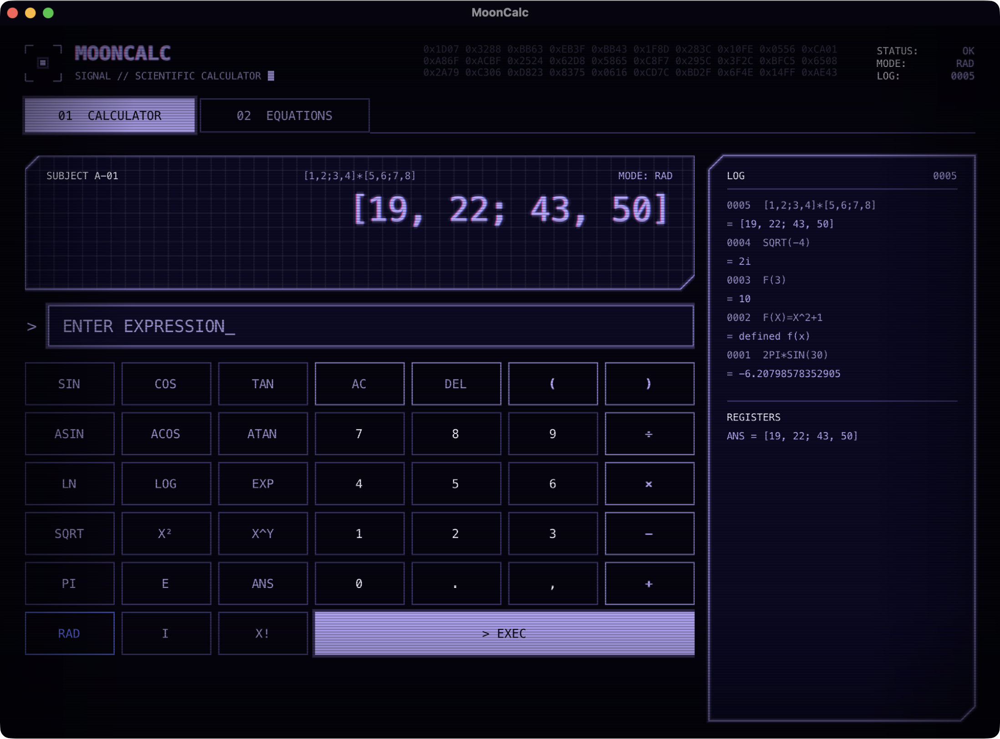
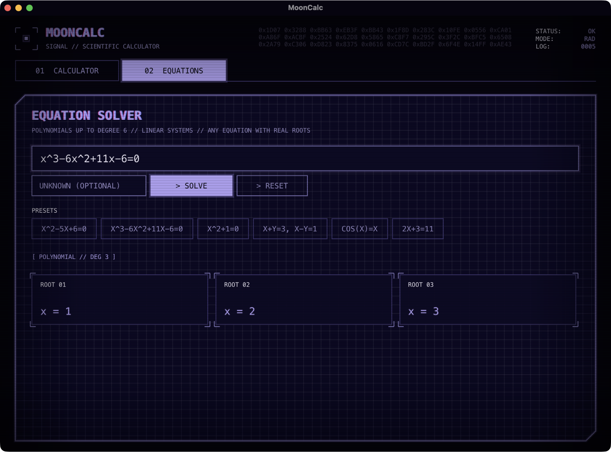

# MoonCalc

An interactive terminal scientific calculator written in C++17, with a retro-futuristic "Ghost Signal" look: near-black CRT background, violet neon, square beveled panels and scanlines. It supports complex numbers, matrices, user-defined functions, calculus, statistics, an equation and linear-system solver, terminal plots and unit conversion.

```
┌─ MOONCALC ───────────────────────────────────────────┐
│  SIGNAL // SCIENTIFIC CALCULATOR                     │
│  STATUS: OK                                          │
│                                                      │
│  help  //  solve x^2-4=0  //  plot sin(x)  //  quit  │
└──────────────────────────────────────────────────────┘
rad > solve x^2-5*x+6=0
  quadratic equation
  ▸ x1 = 2
  ▸ x2 = 3
```

## Graphical interface (macOS)

<p align="center">
  
  
</p>

A native macOS app in the Ghost Signal style (CRT scanlines and vignette, violet neon glow, beveled panels, corner brackets, monospaced HUD labels), built with [Dear ImGui](https://github.com/ocornut/imgui) on Metal.

```bash
make gui
./mooncalc-gui
```

- **Calculator tab:** result display, input field, a scientific keypad, a history panel (click an entry to reuse it) and your variables. Everything the terminal version evaluates works here, including functions you define, complex numbers and matrices.
- **Equations tab:** type an equation or a linear system, optionally name the unknown, and get one card per solution. Click a card to copy its value.

The interface uses Menlo from macOS. To use the original Ghost Signal fonts, place `VT323-Regular.ttf` and `Amanojaku.ttf` in a `fonts/` folder next to where you run `./mooncalc-gui`; they are picked up automatically and the app falls back to Menlo when they are missing.

It needs macOS with the Xcode Command Line Tools (`xcode-select --install`). Dear ImGui v1.91.9 is vendored in `third_party/imgui` (MIT license), so nothing else has to be installed.

## Requirements

| Requirement | Details |
|---|---|
| Operating system | macOS or Linux. Uses `<unistd.h>` (`isatty`); on Windows use WSL. |
| Compiler | Any C++17 compiler (`clang++` 5+, `g++` 7+). |
| Build tool | `make` (optional). The graphical interface also needs macOS and the Xcode Command Line Tools. |
| Terminal | UTF-8 and 24-bit (truecolor) support, plus a font with Braille characters for `plot`, e.g. iTerm2, Kitty, Alacritty, GNOME Terminal, VS Code. A dark background looks best. |
| Dependencies | None beyond the C++ standard library. |

Notes:

- **Colors** are disabled automatically when output is not a terminal (pipes, redirects) or when the `NO_COLOR` environment variable is set.
- **Precision:** calculations use `long double`. On x86-64 Linux this gives about 18 digits; on Apple Silicon `long double` equals `double` (about 15-16 digits). Results are shown with 15 significant digits.
- **Input:** MoonCalc is a REPL reading lines from standard input until `quit` or end of input (Ctrl-D).
- It is not intended for critical computation (financial, medical, safety-related).

## Build and run

```bash
make
./mooncalc
```

Without `make`:

```bash
c++ -std=c++17 -O2 main.cpp -o mooncalc
```

Run the smoke tests:

```bash
make test
```

## Usage

### Basics

| Feature | Syntax |
|---|---|
| Operators | `+ - * / %` and `^` (power, right-associative: `2^3^2 = 512`) |
| Implicit multiplication | `2pi`, `3(4+1)`, `2sin(x)` (same precedence as `*`, so `1/2x = x/2`) |
| Factorial | `5!`, `2.5!` (uses the gamma function) |
| Constants | `pi`, `e`, `i` (imaginary unit), `inf`, `ans` (last result) |
| Variables | `x = 5*2`, then `x^2` |
| User functions | `f(x) = x^2 + 1`, `g(x,y) = x*y`; list them with `funcs` |
| Number formats | `1e-3`, `0xFF`, `0b1010`, `0o17` |
| Angle mode | `deg` / `rad` (the prompt shows the active mode) |

`-2^2` evaluates to `-4`. Complex numbers work everywhere: `sqrt(-4)` is `2i`, `(2+3i)*(1-i)` is `5 + i`.

Line editing: arrow keys move the cursor and browse history; `Ctrl-A`/`Ctrl-E` jump to the start/end, `Ctrl-U`/`Ctrl-K` delete to the start/end, `Ctrl-D` exits on an empty line.

### Functions

Run `help functions` inside the program for the full list.

- Trigonometric and hyperbolic: `sin cos tan asin acos atan atan2 sinh cosh tanh asinh acosh atanh`
- Powers and logs: `sqrt cbrt exp ln log log2 logb root pow mod hypot`
- Complex: `re im conj arg abs`
- Rounding: `floor ceil round trunc sign`
- Special: `fact gamma lgamma beta erf erfc fib`
- Number theory: `gcd lcm nCr nPr isprime`
- Statistics: `mean median var varp std stdp count min max sum prod linreg corr normpdf normcdf`
- Matrices and vectors: `det inv transpose trace rank eye zeros ones rows cols norm dot cross`

### Matrices

```
[1,2;3,4]               rows separated by ';', columns by ','
[1,2;3,4] * [5,6;7,8]   matrix product
[1,2;3,4]^-1            inverse (also inv(M))
det([1,2;3,4])          -2
cross([1,0,0],[0,1,0])  [ 0  0  1 ]
```

Statistics functions accept lists or matrices: `mean([1,2,3,4])`, `linreg([1,2,3],[2,4,6])` (returns slope, intercept, R²).

### Calculus

An optional variable name goes after the expression; the default variable is `x`.

```
diff(sin(x), 0)              1
integral(x^2, 0, 3)          9
limit(sin(x)/x, 0)           1
limit(1/x, inf)              0
sum(k^2, k, 1, 10)           385
prod(k, k, 1, 5)             120
findroot(cos(x)-x, 1)        0.7390851332152
argmin((x-2)^2, 0, 5)        2
```

Numeric methods: `diff` uses a five-point stencil, `integral` an adaptive Simpson rule (improper integrals with integrable singularities are approximated), `limit` uses Richardson extrapolation from both sides (so one-sided or divergent limits report that they differ), and `findroot` uses Newton's method. Results are rounded to about 10 significant digits.

### Solving equations

```
solve 2*x+3=11                 x = 4
solve x^2-5*x+6=0              x1 = 2, x2 = 3
solve x^2+1=0                  x1 = -i, x2 = i
solve x^3-6*x^2+11*x-6=0       x1 = 1, x2 = 2, x3 = 3
solve x+y=3, x-y=1             x = 2, y = 1
solve y: 3*y-1=y+7             y = 4        (explicit unknown)
solve cos(x)=x                 x = 0.739085133
```

- Polynomials up to degree 6 are detected automatically. Linear and quadratic equations use exact formulas; higher degrees use the Durand-Kerner method with refinement and report all complex roots (repeated roots are listed once).
- Square linear systems are solved by Gaussian elimination, and inconsistent or underdetermined systems are reported.
- Any other equation falls back to a numeric search for **real** roots in `[-100, 100]`. It can miss roots that are extremely close together.
- The unknown is detected automatically when exactly one identifier is undefined. Otherwise specify it with `solve <var>: equation`.

### Plots

```
plot sin(x)
plot x^2-3 from -4 to 4
```

Draws the function with Braille characters inside a panel (64x16 cells). The vertical range adapts automatically, and extreme values near asymptotes are clipped.

### Number tools

```
factor 600851475143     600851475143 = 71 × 839 × 1471 × 6857
hex 255   bin 10   oct 8   base 255 7
convert 100 km to mi    convert 100 C to F      (list units with: units)
bigfact 100   bigpow 2 200   bigfib 300         (exact big integers)
```

`bigfact` accepts n up to 20000, `bigpow` exponents up to 100000 and `bigfib` n up to 50000. These exact commands are separate from the floating-point calculator, so they do not need any external library.

### Commands

`help`, `help functions`, `vars`, `funcs`, `units`, `deg`, `rad`, `quit` / `exit`.

## Project layout

```
value.hpp        scalar/complex/matrix value type and operators
numeric.hpp      numeric algorithms: roots, integration, limits, primes
calculator.hpp   parser, function library, equation solver
format.hpp       number and value formatting shared by both interfaces
bigint.hpp       exact big integers (factorial, power, Fibonacci)
units.hpp        unit conversion table
lineedit.hpp     terminal line editor with history
main.cpp         terminal interface (colors, panels, plot, commands)
gui_ui.hpp       graphical interface layout and theme (Dear ImGui)
gui.mm           macOS window and Metal host for the graphical interface
third_party/     vendored Dear ImGui
docs/            screenshots
Makefile         build and test targets
tests/smoke.sh   end-to-end smoke tests
```

## License

MIT. See [LICENSE](LICENSE).
